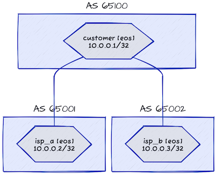

# Enforcing Default EBGP Policy (RFC 8212) — by hand, on Arista EOS

This lab shows the **hairpin leak** through a customer AS, and how RFC 8212
semantics stop it.

`customer` (AS 65100) peers with `isp_a` (65001) and `isp_b` (65002), which do
not peer with each other. With no policy anywhere, `customer` accepts isp_a's
`10.0.0.2/32` and re-advertises it to isp_b — and isp_b's `10.0.0.3/32` to
isp_a. A stub customer has silently become transit between two ISPs.



## This lab was ported from FRR, and what it teaches changed with it

The original version demonstrated FRR's **default** behaviour: FRR implements
RFC 8212, netlab switches it off with `no bgp ebgp-requires-policy`
(`netsim/ansible/templates/bgp/frr.j2`), and `8212-default/frr.j2` re-rendered
the BGP block without that line to bring the default back.

**Arista EOS does not implement RFC 8212 at all.** There is no knob to restore
and netlab's `bgp/eos.j2` has nothing to disable — on EOS the hairpin leak is
simply the default. Skyforge does not admit `frr` as a NOS, so the customer is
`eos` and `8212-default/eos.j2` **constructs** the behaviour instead:

```
route-map RFC8212-DENY deny 10
!
router bgp 65100
 address-family ipv4
  neighbor 10.1.0.2 route-map RFC8212-DENY in
  neighbor 10.1.0.2 route-map RFC8212-DENY out
  neighbor 10.1.0.6 route-map RFC8212-DENY in
  neighbor 10.1.0.6 route-map RFC8212-DENY out
```

So the lab now teaches **how to build RFC 8212 semantics by hand on a platform
that lacks them**, not "watch a default do its job". `8212-default/frr.j2` is
kept alongside as the contrast — it is the same rule expressed as an absence.

Deny goes **in and out, on every EBGP session**. Outbound alone would stop the
leak, but RFC 8212 is not "do not re-advertise" — it is "no prefix crosses an
EBGP session in either direction until you say so", and that covers the
customer's own `10.0.0.1/32` too.

## Seeing it

Bring the lab up, then look at isp_b **before** applying the custom config:

```
netlab up
netlab connect isp_b -c "show ip bgp"      # 10.0.0.2/32 present, AS path 65100 65001
netlab validate                            # no_hairpin_* FAIL — this is the leak
```

Then apply it and look again:

```
netlab config 8212-default
netlab connect isp_b -c "show ip bgp"      # no path to 10.0.0.2/32
netlab validate                            # all checks pass
```

The `validate:` block in `topology.yml` encodes exactly that claim, so the lab
proves itself rather than asking you to take its word. Reference:
[Default EBGP Policy (RFC 8212)](https://blog.ipspace.net/2023/06/default-ebgp-policy-rfc-8212.html).

## Changing device types

`netlab up -s nodes.customer.device=<device>` still works for any device netlab
supports, but note that `8212-default/` only carries `eos.j2` and `frr.j2`.
Another device needs its own fragment; without one netlab fails the compile with
`Cannot find 8212-default configuration template`, which is the honest outcome —
the lab cannot demonstrate the rule on a platform it has no way to express it on.
