# NANOG 98: What Building a Network Emulation Platform Taught Me About Digital Twins

Monday 2026-10-19, 2:00 PM Eastern, Versailles. 45 minutes including Q&A. Deck v15: 25 presented slides (39:00), Questions (6:00), and an appendix that is not presented.

Each slide below is the rendered slide followed by its speaker notes. Click cues are listed at the end of the notes. The source is the v14 deck; the demo clip on slide 19 is not embedded here.

Labels used in the talk: *proven live*, *off by default*, *designed and prototyped*. See the open-items doc in `docs/drafts/napalm/` for what is built and what is not.

---

## 1. What Building a Network Emulation Platform Taught Me About Digital Twins

Speaker notes

DELIVERY 00:00–00:30 (30 seconds).

I built Skyforge because I wanted disposable networks that were useful for real engineering. I wanted to run different network operating systems, test automation and repeat a failure without rebuilding everything by hand. The interesting part of this talk is what happened when I started asking that lab questions about production.

I am a Principal Architect at Forward Networks. I work with commercial digital twins, and I will show where Predict fits. The story starts with the platform I built and ends with a workflow that does not depend on a particular vendor.

The useful distinction is between evidence from executing a particular implementation and evidence computed from a supported representation. I will use one routing change to make that distinction concrete. The point is a change decision, not a contest between products.

CLICK CUES

Static slide. Advance after the transition.

TRANSITION

First, one puzzle.

---

## 2. Which one is wrong?

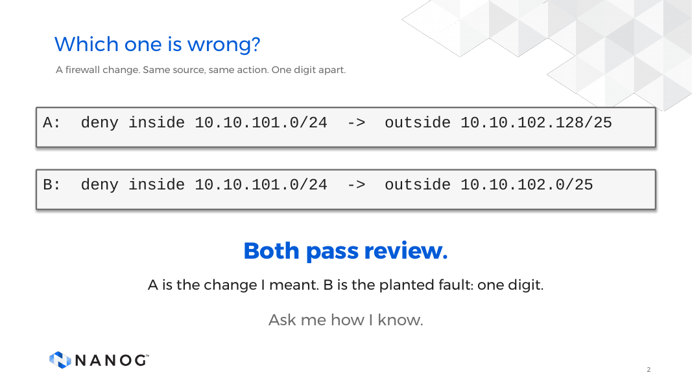

Speaker notes

DELIVERY 00:30–01:30 (60 seconds).

After the title, one slide before the thesis. Two firewall rules. Same source, same action, deny the inside LAN. They differ by one digit in the destination. Read both out, then pause and let the room look.

CLICK 1: 'Both pass review.' and the answer. A is the change I meant to make: retire a range that nothing uses. B is the fault I planted. B covers the lower half, where the one host that matters lives, so it shadows the permit for exactly the flow I care about. I did not catch that by reading it. I'll show you what did.

CLICK 2: 'Ask me how I know.' Let it land.

Then: This talk is about how I got from an emulator to a twin, and what I do when a change looks fine.

CLICK CUES

1. On click: Both pass review. + A is the change I meant. B is the planted fault:.

2. On click: Ask me how I know..

TRANSITION

The thesis.

---

## 3. An emulator is not a digital twin

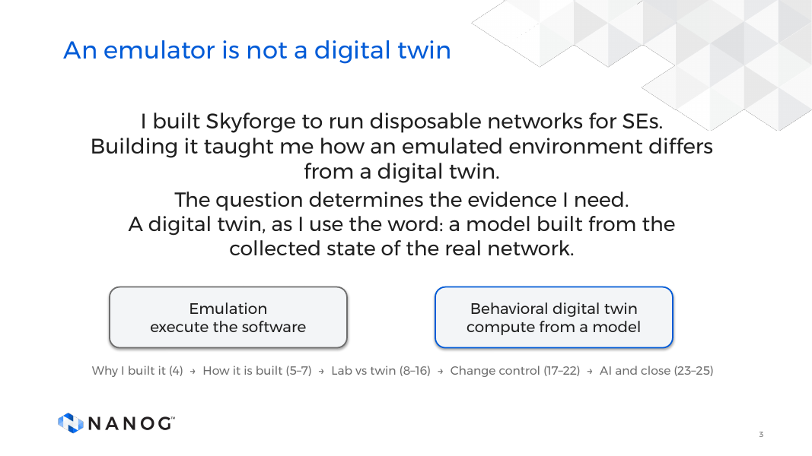

Speaker notes

DELIVERY 01:30–03:00 (90 seconds).

Here is the thesis in one line. An emulator is not a digital twin. They are different kinds of thing, and building an emulator is what made that visible to me.

Let me define the two words once, because I will use them all talk. An emulator runs the real software on virtual hardware and answers: what does this software do? A digital twin, as I use the word, is a model built from the collected state of the real network. It answers: what would the real network do?

Neither is a better version of the other. The question I am asking decides the evidence I need. The strip at the bottom is the arc. Why I built it and how it is built. What the lab and the twin each tell me. Then how I run a change now: the lab proves the machinery works, and the twin judges the change. I need both.

CLICK CUES

1. On click: I built Skyforge to run disposable networks for .

2. On click: The question determines the evidence I need. / A.

3. On click: Emulation / execute the software.

4. On click: Behavioral digital twin / compute from a model.

5. On click: Why I built it (4)  →  How it is built (5–7)  → .

TRANSITION

Why I built it.

---

## 4. Why I built Skyforge

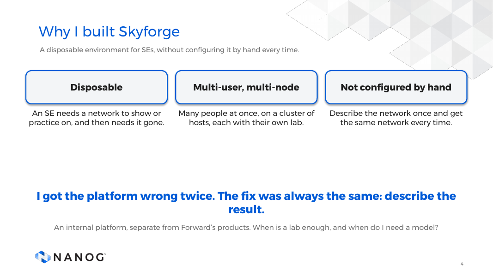

Speaker notes

DELIVERY 03:00–04:25 (85 seconds).

I started Skyforge because I do this for a living. Sales engineers need a network to show a customer, or to practice on, and they need it quickly and disposable. Building one by hand every time does not scale.

So the requirements were simple to state. Many people at once. Labs that can spread across more than one host. And no manual configuration: I describe the network once and get the same network back every time.

This is an internal platform I built. It is separate from Forward's products. Along the way it raised a second question: when is a lab enough, and when do I need a model of the real network? That second question is what this talk is about, and Forward appears as the digital twin I compare against.

I got the platform wrong twice, and I want to say so. First I tried to fit containerlab in natively with clabernetes, which runs Docker inside Docker inside pods. KNE replaced it in March 2026. Then I rolled my own hosts and ran k3s on them, so I owned every patch. Talos replaced that in July. Underneath both, my early scripts did steps instead of describing the result. Each of those breaks differently each time you run it. The fix was the same every time: describe the result, and let something reconcile it where I can.

CLICK CUES

1. On click: Disposable + An SE needs a network to show or practice on, an.

2. On click: Multi-user, multi-node + Many people at once, on a cluster of hosts, each.

3. On click: Not configured by hand + Describe the network once and get the same netwo.

4. On click: I got the platform wrong twice. The fix was alwa.

5. On click: An internal platform, separate from Forward’s pr.

TRANSITION

Here is the pipeline.

---

## 5. One declaration, a running network

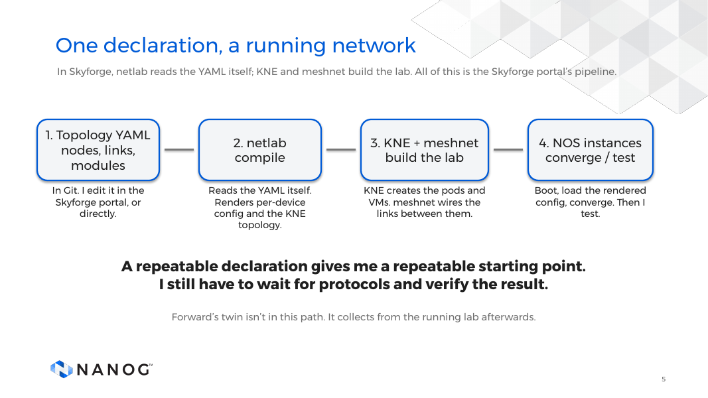

Speaker notes

DELIVERY 04:25–05:10 (45 seconds).

The only input is the topology YAML: devices, links and protocol modules. It lives in Git and I edit it in the Skyforge portal or directly. To answer the question about the YAML: yes, netlab reads that YAML itself. Nothing in Skyforge translates it by hand. netlab compiles it into two things: the configuration for every device, and, through the KNE provider in our netlab patch set, the topology that KNE needs.

KNE then creates one pod or VM per device on Kubernetes, and meshnet wires the links between them. Once the instances exist, the configuration netlab rendered is loaded and the protocols still have to converge and the tests still have to run. Forward Networks is not in this path. It collects from the running lab afterwards, which is where the digital-twin half of the talk starts.

I use deterministic here to describe the validated authoring and execution path. I do not mean that BGP scheduling, boot duration or a distributed system will reproduce the same wall-clock trace every time. The engineering benefit is a known, reviewable starting point. When a result surprises me, I can inspect the declaration and the resulting configuration instead of guessing what someone clicked.

A successful deployment of workloads is only a lifecycle result. A declaration error, a workload launch failure and a BGP failure are different problems even if they all end with an unusable lab.

CLICK CUES

1. On click: 1. Topology YAML / nodes, links, modules + In Git. I edit it in the Skyforge portal, or dir.

2. On click: 2. netlab / compile + Reads the YAML itself. Renders per-device config.

3. On click: 3. KNE + meshnet / build the lab + KNE creates the pods and VMs. meshnet wires the .

4. On click: 4. NOS instances / converge / test + Boot, load the rendered config, converge. Then I.

5. On click: A repeatable declaration gives me a repeatable s.

6. On click: Forward’s twin isn’t in this path. It collects f.

TRANSITION

What a declaration looks like.

SOURCE

supplied Skyforge design; https://netlab.tools/ ; https://github.com/openconfig/kne

---

## 6. What the declaration looks like

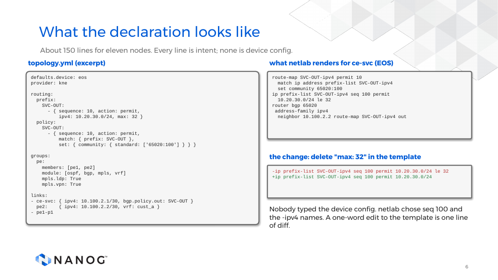

Speaker notes

DELIVERY 05:10–06:45 (95 seconds).

This is what an SE actually writes. It is the template for the eleven-node lab I use later in the talk, trimmed to the parts that matter. There is no device configuration in it. It says what the network is: a routing policy, a group of provider edge routers with the protocols they run, and the links, with one policy attached to one session.

On the right is what netlab renders from it for one router. I did not type that. netlab chose the prefix-list sequence number and the names.

And the change I examine later in the talk is a one-word edit to the template, removing the length qualifier. In the rendered config that is exactly one line of diff. Hold on to that line, because it is the line both machines will be asked about.

CLICK CUES

1. On click: v12_n1_yaml_panel + defaults.device: eos / provider: kne /   / routi + topology.yml (excerpt).

2. On click: v12_n1_render_panel + route-map SVC-OUT-ipv4 permit 10 /   match ip ad + what netlab renders for ce-svc (EOS).

3. On click: v12_n1_diff_panel + -ip prefix-list SVC-OUT-ipv4 seq 100 permit 10.2 + the change: delete "max: 32" in the template.

4. On click: Nobody typed the device config. netlab chose seq.

TRANSITION

How big does it get?

---

## 7. The nodes weren’t the limit. A controller was.

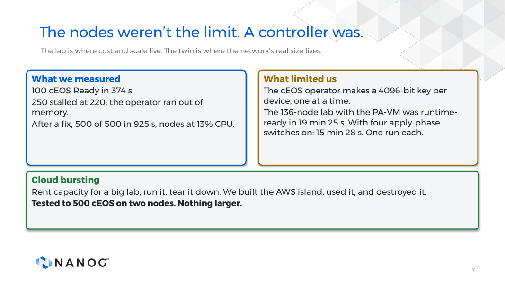

Speaker notes

DELIVERY 06:45–08:00 (75 seconds).

A short slide on scale, and what I actually measured. It ties to the thesis in one sentence. The lab is where cost and scale live. The twin is where the network's real size lives.

On the ninth of October I built a two-node island in AWS and ran real Arista cEOS on it. A hundred pods Ready in 374 seconds. At 250 it stalled at 220. The nodes were nowhere near their limits. The cEOS operator was killed for memory 26 times and pinned on CPU, because it generates a 4096-bit key for every device and works through them one at a time. After the operator got more CPU and memory, 500 of 500 were Ready in 925 seconds, with the two nodes at 13 percent CPU and 20 percent memory.

Separately, the 136-node fleet lab with the PA-VM was runtime-ready in 19 minutes 25 seconds with the four apply-phase switches off, and 15 minutes 28 seconds with them on. One run each, so treat it as a result, not a benchmark. The data plane across the firewall was checked: ARP resolved and ping across the firewall worked.

Cloud bursting means renting capacity for a big lab, running it, and tearing it down. We built the island, used it, and destroyed it. Tested to 500 cEOS on two nodes. Anything bigger is planned and not run. The lesson: fix the operator before buying more nodes. Turns out routers don't care about our capacity planning spreadsheet.

CLICK CUES

1. On click: v14_ns_a_panel + What we measured / 100 cEOS Ready in 374 s. / 25.

2. On click: v14_ns_b_panel + What limited us / The cEOS operator makes a 4096.

3. On click: v14_ns_c_panel + Cloud bursting / Rent capacity for a big lab, ru.

TRANSITION

Now, what only a lab gives me.

---

## 8. What only an emulator gives me

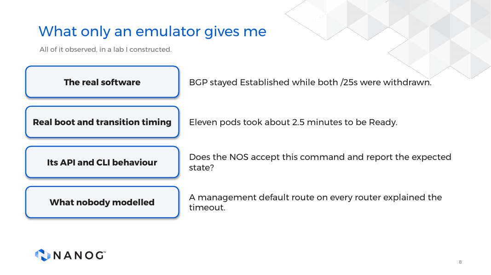

Speaker notes

DELIVERY 08:00–08:50 (50 seconds).

This is what an emulator is uniquely good at. It runs the real software, so I see what the implementation actually does: the BGP session stayed Established while the router withdrew both prefixes. It gives me real boot and transition timing for that virtual setup. It shows API and CLI behaviour. And it exposes things nobody modelled; in my lab a management default route on every router is why the failure was a timeout, not a refusal.

All of that is observed behaviour of a network I constructed. That is its strength, and also what makes it a different kind of thing from a digital twin.

CLICK CUES

1. On click: The real software + BGP stayed Established while both /25s were with.

2. On click: Real boot and transition timing + Eleven pods took about 2.5 minutes to be Ready..

3. On click: Its API and CLI behaviour + Does the NOS accept this command and report the .

4. On click: What nobody modelled + A management default route on every router expla.

TRANSITION

It gives me a lot. And it can still be right about the wrong network.

---

## 9. The lab can be right about the wrong network

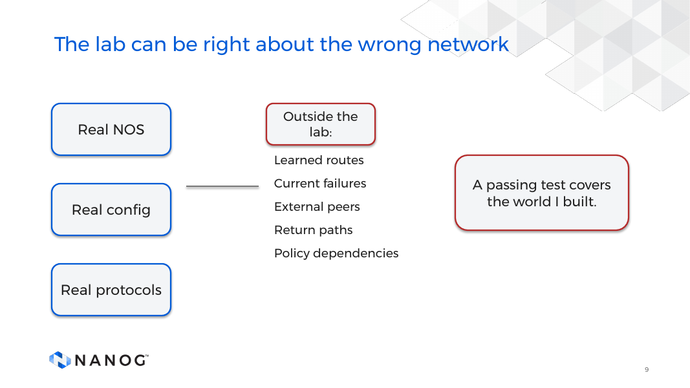

Speaker notes

DELIVERY 08:50–09:35 (45 seconds).

Imagine that the configuration looks familiar but the lab advertises a summary while production advertises more-specific routes. The same prefix-list edit can have a different effect in those two environments. Both routers may execute their configuration correctly. The difference is the route input.

The same problem appears with external peers, return paths, current failures and dependencies outside the copied topology. A passing probe proves something about the case I exercised. It does not silently quantify over every source, destination, protocol and state. This is the distinction the worked example will make concrete.

Imagine the lab has a default route that production lacks. The HTTPS probe succeeds and the software behaves exactly as configured. The test can still mislead the change decision. The reverse can happen too: an omitted return route makes a correct change appear broken. I need to compare the relevant context before I interpret pass or fail.

CLICK CUES

1. On click: Real NOS.

2. On click: Outside the lab: + Learned routes / Current failures / External pee + Connector 7.

3. On click: A passing test covers / the world I built..

4. On click: Real config.

5. On click: Real protocols.

TRANSITION

Which is a different question from the one a lab answers.

---

## 10. An emulator and a digital twin differ in kind

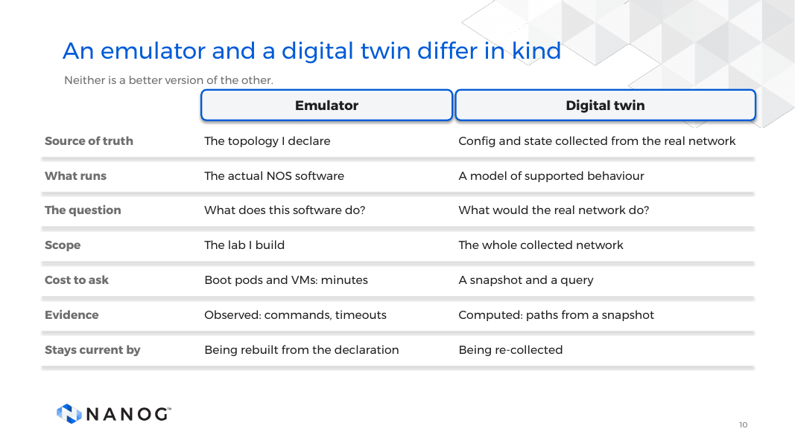

Speaker notes

DELIVERY 09:35–11:00 (85 seconds).

This is the core of the talk. They are different kinds of thing, not a better and a worse version.

An emulator's source of truth is the topology I declare, and it runs the actual software, so it answers what this software does, for the lab I built, with observed evidence. It stays current by being rebuilt from the declaration, and each question costs a boot.

A digital twin's source of truth is configuration and state collected from the real network. It runs a model of supported behaviour, so it answers what the real network would do, across the whole collected network, with computed evidence. It stays current by being re-collected, and a question costs a query.

Seen that way, the two are complementary. The next slides show them side by side on one change.

CLICK CUES

1. On click: Emulator + Digital twin + Source of truth + 3 more.

2. On click: What runs + The actual NOS software + A model of supported behaviour + 1 more.

3. On click: The question + What does this software do? + What would the real network do? + 1 more.

4. On click: Scope + The lab I build + The whole collected network + 1 more.

5. On click: Cost to ask + Boot pods and VMs: minutes + A snapshot and a query + 1 more.

6. On click: Evidence + Observed: commands, timeouts + Computed: paths from a snapshot + 1 more.

7. On click: Stays current by + Being rebuilt from the declaration + Being re-collected + 1 more.

TRANSITION

One change, run on both machines.

---

## 11. Eleven nodes, one policy boundary

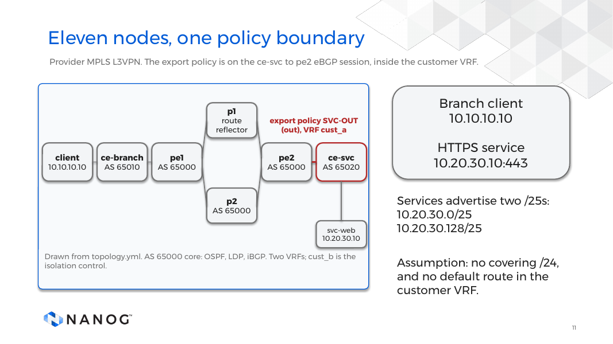

Speaker notes

DELIVERY 11:00–12:10 (70 seconds).

Walk from the branch client through ce-branch, the provider core and ce-svc to the HTTPS endpoint. The customer branch is AS 65010 and the customer services site is AS 65020. In between is a provider MPLS network, AS 65000: two PEs, two P routers, with p1 acting as route reflector. OSPF is the underlay, LDP carries labels, and the customer routes are VPNv4 with eBGP to the customers inside VRF cust_a.

The candidate export policy is on ce-svc toward pe2. The source is 10.10.10.10 and the destination is 10.20.30.10 on TCP 443. ce-svc advertises 10.20.30.0/25 and 10.20.30.128/25. There is no covering /24 and no default route in the customer VRF. Be careful with the word default: every router also has a management default route, which I come back to. The return prefix 10.10.10.0/24 is reachable and unchanged.

The second /25 gives me an impact question beyond a single HTTPS endpoint. A successful probe to one address would not establish the fate of the other half of the /24. This diagram is drawn from the topology file; the portal also has a map view of the same eleven nodes, but with this many links it is not readable on a slide.

CLICK CUES

1. On click: Topology diagram (drawn from topology.yml) + client / 10.10.10.10 + ce-branch / AS 65010 + 16 more.

2. On click: Branch client / 10.10.10.10 /  / HTTPS service /.

3. On click: Services advertise two /25s: / 10.20.30.0/25 / 1.

4. On click: Assumption: no covering /24, and no default rout.

TRANSITION

Now connect the declaration to the running network.

---

## 12. Skyforge: what I observed

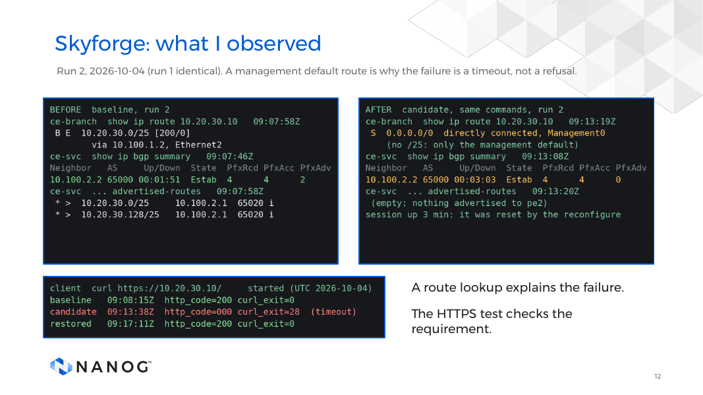

Speaker notes

DELIVERY 12:10–13:20 (70 seconds).

Reveal the before capture first. Point to the selected /25 on ce-branch and to ce-svc advertising two prefixes to pe2 with the session Established. Reveal the after capture and compare the same commands. The route lookup now returns only the management default route, ce-svc advertises zero prefixes, and the session is still Established, so an adjacency check would have passed while the service requirement failed. Note that the session shows about three minutes up: the reconfigure reset it earlier, and the capture is of the settled state.

The strip underneath is the client test, with timestamps: HTTP 200 in the baseline, curl exit 28 in the candidate, HTTP 200 again when restored. Exit 28 is a timeout, not a refusal, and that is because every router has a management default route, so the packet is not rejected for lack of a route. The negative control, a request to 10.20.30.77, failed in every phase.

These are readable excerpts of the raw record: the first lines of each command output are trimmed, nothing is invented, and the full files are in the evidence folder. A route lookup explains the failure and the HTTPS test checks the requirement. The second /25 was checked in the raw record too.

CLICK CUES

1. On click: the picture.

2. On click: the picture.

3. On click: the picture.

4. On click: A route lookup explains the failure..

5. On click: The HTTPS test checks the requirement..

TRANSITION

Now the same baseline and edit in the model.

---

## 13. Predict: the evidence I need

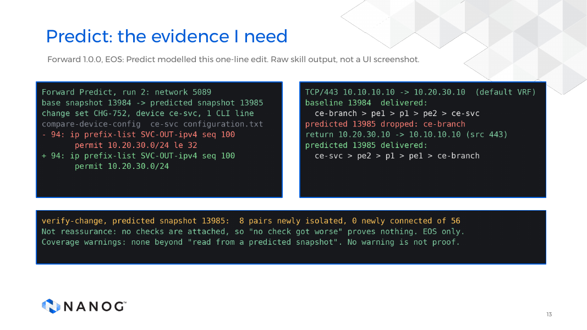

Speaker notes

DELIVERY 13:20–14:30 (70 seconds).

Show the snapshot identity and the candidate edit first. Base snapshot 13984 was collected from the lab, change set CHG-752 stages one CLI line on ce-svc, and predicted snapshot 13985 is the result. The config comparison shows exactly the one line removed and one added, the same line netlab rendered for the candidate.

Then the path query with the same endpoints, protocol and VRF as the lab. On the baseline snapshot TCP 443 is delivered through ce-branch, pe1, p1, pe2 and ce-svc. On the predicted snapshot the forward path is dropped at ce-branch, and the return path from the service is still delivered. The impact view says eight of 56 subnet pairs are newly isolated and none newly connected.

Keep the limits visible. No checks are attached to this network, so the statement that no check got worse is not evidence. The only warning returned was that the result is read from a predicted snapshot, and the absence of other warnings is not proof of full coverage. These are raw outputs of the Forward skills, not a screenshot of the Forward UI. Still unknown: ECMP path enumeration, asymmetric route targets, cross-VRF isolation inside Forward, and BGP-LU or SR variants. They were not tested, which is not the same as unsupported.

CLICK CUES

1. On click: the picture.

2. On click: the picture.

3. On click: the picture.

TRANSITION

Here is what the comparison can establish.

SOURCE

https://www.forwardnetworks.com/predict/

https://www.forwardnetworks.com/blog/2026/09/29/forward-predict-is-now-generally-available/

Public documentation describes BGP/routing change analysis. Exact version/feature/candidate support requires verification in the actual environment.

---

## 14. Same intent, different evidence

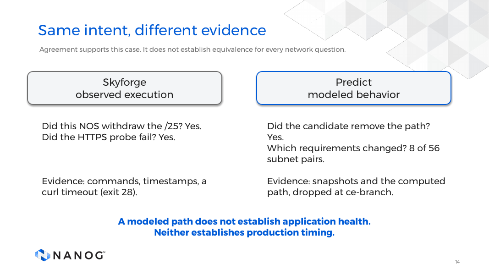

Speaker notes

DELIVERY 14:30–15:40 (70 seconds).

The common intent is branch HTTPS reachability. Skyforge gives me an execution trace from particular NOS instances and tests. Predict gives me a computed path result for a particular snapshot and supported change. In this case they agree: both say the service path is lost, both /25s are gone, and the return direction is still reachable.

They agree on the outcome but not on its form. The lab showed an HTTPS timeout, curl exit 28, because the CE has a management default route. Predict reported an explicit drop at ce-branch. That difference is itself information about what each machine represents.

Do not call this a benchmark. No timing or scale claims come from it. A network path result does not validate server health, and neither a stable-state model nor a virtual-lab trace establishes the interruption duration on production hardware. If both support loss of the path, the next action is to hold or revise the change. Agreement on this case leaves other questions open, especially transition timing and hardware behavior.

CLICK CUES

1. On click: Skyforge / observed execution.

2. On click: Did this NOS withdraw the /25? Yes. / Did the HT.

3. On click: Evidence: commands, timestamps, a curl timeout (.

4. On click: Predict / modeled behavior.

5. On click: Did the candidate remove the path? Yes. / Which .

6. On click: Evidence: snapshots and the computed path, dropp.

7. On click: A modeled path does not establish application he.

TRANSITION

When do I reach for which?

---

## 15. I reach for emulation when software matters

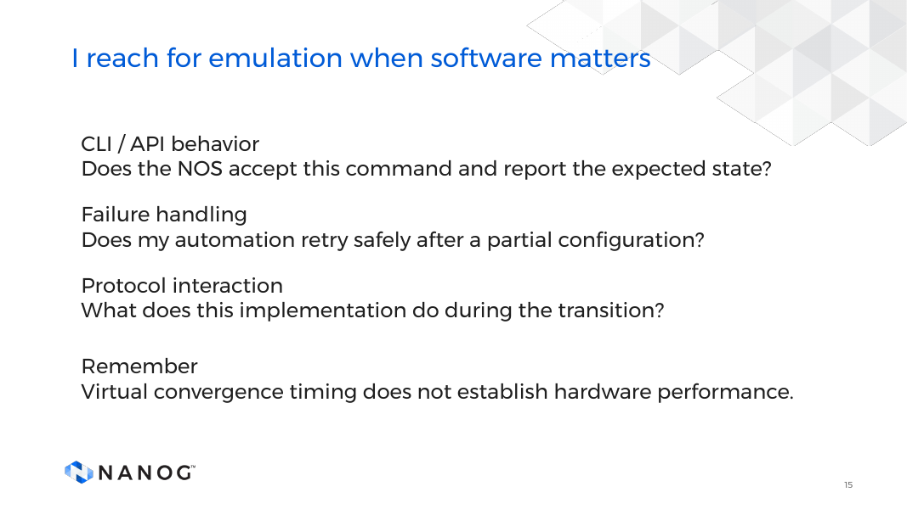

Speaker notes

DELIVERY 15:40–16:10 (30 seconds).

My first instinct remains emulation when the uncertainty is in software interaction. I want to know whether configuration applies, what the API reports and whether automation behaves sensibly after a partial failure. The implementation itself is the subject.

The lab is also useful for protocol transitions and reproducing a specific defect, provided I use the relevant software and conditions. I still separate a functional reproduction from a performance claim. Running the same NOS code in a virtual workload does not reproduce every hardware forwarding or timing property.

Emulation is particularly useful when the uncertainty is in a command sequence, an API response or a retry after partial configuration. Those are observable software interactions. The topology can be small if it preserves the conditions needed to exercise that interaction.

CLICK CUES

1. On click: CLI / API behavior / Does the NOS accept this co.

2. On click: Failure handling / Does my automation retry safe.

3. On click: Protocol interaction / What does this implementa.

4. On click: Remember / Virtual convergence timing does not e.

TRANSITION

Other questions send me to the model.

---

## 16. I reach for a model when scope matters

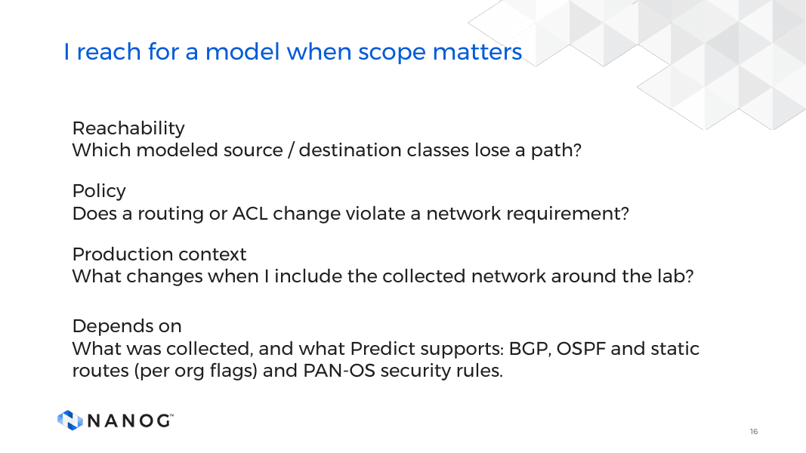

Speaker notes

DELIVERY 16:10–16:40 (30 seconds).

I start with the model when the uncertainty is about the represented network's scope: which paths change, where a policy blocks traffic, or which requirements are affected across many devices. Rebuilding that context in a small lab can be the wrong investment.

But I do not smuggle completeness into the word model. The result is constrained by collected state, supported semantics and the query. If those inputs are missing, I need collection, another method or an explicit unknown. That is the same discipline I want on the emulation side.

A model lets me ask about the represented context without building every device as a running instance. I still need a specified query and supported behavior. Scope is useful only when I can explain what was collected, what the computation included and what remains outside it.

Failure impact is the other question I would put to a model: if this link or node goes away, which paths lose reachability, across the whole collected scope. I am not showing a failure-impact run in this talk, so I won't claim one. What I can show is the lab side of the same question. Demo 4 shuts a link on the ring, and the lab tells me how the software on the devices reacts. The model would tell me which paths in my network depend on that link. Same split as everywhere else in the talk: the lab for what this software does, the model for what happens in my network.

CLICK CUES

1. On click: Reachability / Which modeled source / destinatio.

2. On click: Policy / Does a routing or ACL change violate a .

3. On click: Production context / What changes when I include.

4. On click: Depends on / What was collected, and what Predic.

TRANSITION

That is the twin as a judge. Now: a change that waits until the twin has judged it.

---

## 17. A change waits until the twin has judged it

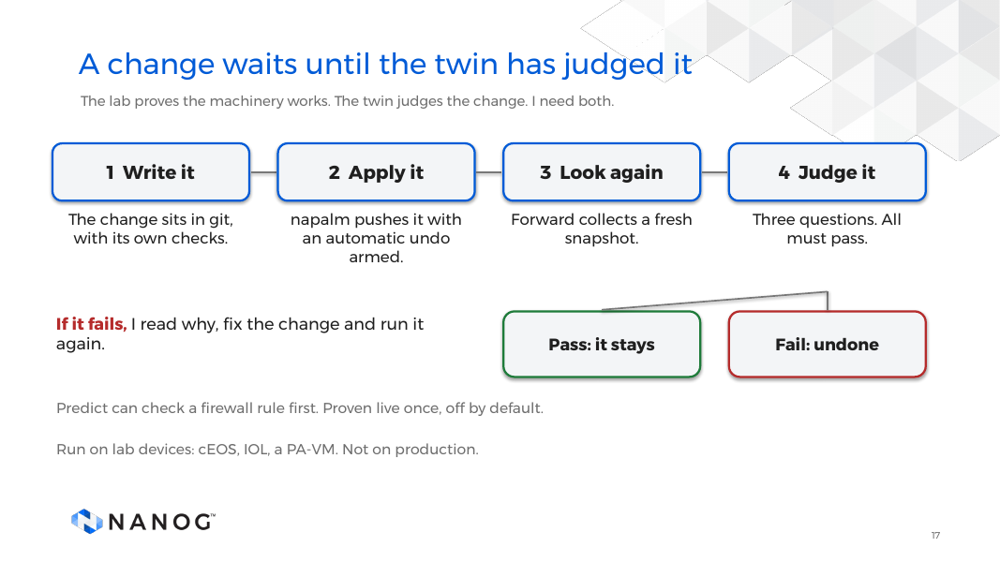

Speaker notes

DELIVERY 16:40–19:30 (170 seconds).

This is how I run a change now. It has run on lab devices, and the idea is the spine of the second half of the talk.

There are two machines in it. The lab proves that the machinery works. It applies the change, holds it, and undoes it, on the real device. The twin, Forward, judges the change. You need both. A twin can tell you the change is bad. It cannot tell you your undo works.

Here's what it actually does. The change is in git, with its own checks. When someone runs it, napalm pushes the config to the running lab and arms an automatic undo. Netlab still makes the initial config. From then on napalm owns changes. Forward then collects a fresh snapshot of the changed network and asks three questions. If every one passes, the undo is cancelled and the change stays. If one fails, the change is undone and the run says which check failed.

After a fail, I read why, fix the change and run it again. Each run gets a fresh baseline. Predict can look at a firewall rule before any device is touched. That has been proven live once and is off by default.

Scope: cEOS, IOL and a Palo Alto PA-VM, in labs. Not production, and I wouldn't claim it.

CLICK CUES

1. On click: 1  Write it + The change sits in git, with its own checks..

2. On click: Connector 18 + 2  Apply it + napalm pushes it with an automatic undo armed..

3. On click: Connector 21 + 3  Look again + Forward collects a fresh snapshot..

4. On click: Connector 24 + 4  Judge it + Three questions. All must pass..

5. On click: Pass: it stays + Fail: undone + Connector 29 + 1 more.

6. On click: If it fails, I read why, fix the change and run .

7. On click: Predict can check a firewall rule first. Proven  + Run on lab devices: cEOS, IOL, a PA-VM. Not on p.

TRANSITION

So what does Forward ask?

---

## 18. Forward asks three things

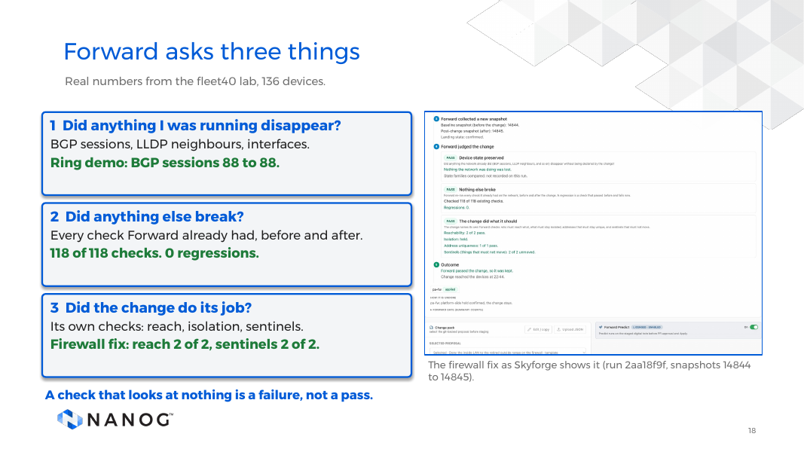

Speaker notes

DELIVERY 19:30–22:10 (160 seconds).

Forward judges a change with three questions, and each catches something the others can't.

One: did anything I was running disappear? Forward compares what it collected before and after. BGP sessions, LLDP neighbours, interface state. On the ring demo, the fix showed BGP sessions 88 before and 88 after.

Two: did anything else break? Forward re-runs every check it already had, on both snapshots. Only a check that passed before and fails now counts against the change. On the firewall fix it was 118 of 118, no regressions.

Three: did the change do its job? The change names its own checks. Who must reach what, what must stay isolated, which paths must not move. On the firewall fix, reachability two of two and both sentinels unmoved.

On the right is the card Skyforge shows for the firewall fix, run 2aa18f9f, baseline 14844, after 14845. Applied and held, with the undo and its deadline, then the new snapshot, then the three judgements, then the outcome. I cropped it to the card.

One rule I care about: a check that looks at nothing is a failure, not a pass. An empty result never reads as healthy.

CLICK CUES

1. On click: v14_n2_c0_panel + 1  Did anything I was running disappear? / BGP s.

2. On click: v14_n2_c1_panel + 2  Did anything else break? / Every check Forwar.

3. On click: v14_n2_c2_panel + 3  Did the change do its job? / Its own checks: .

4. On click: the picture + The firewall fix as Skyforge shows it (run 2aa18.

5. On click: A check that looks at nothing is a failure, not .

TRANSITION

Now watch it happen.

---

## 19. A one-digit mistake, held and undone

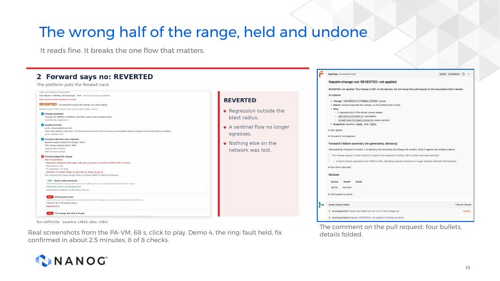

Speaker notes

DELIVERY 22:10–28:50 (400 seconds).

PLAY THE CLIP (68 seconds, click the video) and narrate over it. It is built from real screenshots of the live PA-VM: the run card on one side and three short bullets on the other. One consistent pair of runs: the break is run b6f0435e, the fix is run 2aa18f9f, and pull request #27 carries both comments. Beats: 4 s intro; 7 s break HELD; 7 s REVERTED; 7 s the evidence behind the no; 7 s the comment on the pull request for the break; 6 s fix HELD; 7 s CONFIRMED; 6 s the evidence behind the yes; 7 s the comment on the pull request for the fix; 5 s closing card.

1. HELD (4 to 11 s). The change is the deny rule with the planted digit, B from the first slide. The platform applies it to the firewall and holds it. It is on the box, but not kept. The undo is platform-side, because PAN-OS has no commit-confirm. Forward is judging it.

2. NO, then REVERTED (11 to 18 s). Forward says no, and the platform restores its saved snapshot. Baseline snapshot 14840, after 14841.

3. The evidence behind the no (18 to 25 s). 118 checks, 2 regressions. Reachability one of two, sentinels one of two. The regression is pd3_fwin_h_to_fwout_h, pass to fail, and the failing sentinel is sn_pd3_fwin_to_fwout_via_pa_fw. Dry aside, if it fits: the firewall did exactly what I told it. That was the problem.

4. The comment on the pull request (25 to 32 s). This is where the result lands for the person who proposed the change. The comment is four bullets, and the details are folded away. It says REVERTED: not applied, and that this change is not on the devices, so don't merge on the assumption that it landed. At a glance: the change, the result, why (2 regressions, the two named checks), and the snapshots. Forward's AI summary is below, labelled advisory. It doesn't change the verdict. The status check at the bottom is red.

5. The fix, HELD (32 to 38 s). Same hold, same judging. The fix writes the one wrong address correctly.

6. CONFIRMED (38 to 45 s). Baseline 14844, after 14845. Forward passed the change, so it was kept.

7. The evidence behind the yes (45 to 51 s). 118 of 118 existing checks pass, no regressions. Reachability two of two, sentinels two of two unmoved. The platform-side hold is confirmed, so the change stays.

8. The comment on the pull request for the fix (51 to 58 s). APPLIED and CONFIRMED. Result: Forward passed the change, it stays. The status check is green: sweep 118 of 118, 0 regressions. This was captured live for the first time. You'll see a pending 'Predict pre-flight has not run for this change yet'. That is right: the pre-flight is off by default.

Closing card (58 to 68 s): the lab proves the machinery works, and the twin judges the change.

Notes for you. The Run fix and Run break buttons in the portal now execute the run themselves. If the video won't play, the slide shows a still from the REVERTED beat. Demo 4, the ring, in one line: the planted fault also shut a second link and cut a router off. Held, with 'no path found on the collected network' and an LLDP adjacency nobody declared. The fix, shutting one link, was confirmed in about two and a half minutes, eight of eight checks.

I didn't catch the digit by reading it. Neither would a linter. It read fine in review, which tells you something about reviews.

CLICK CUES

1. On click: play the clip.

2. On click: the picture + The comment on the pull request: four bullets, d.

TRANSITION

Firewalls are different.

---

## 20. A firewall can’t undo itself, so the platform does

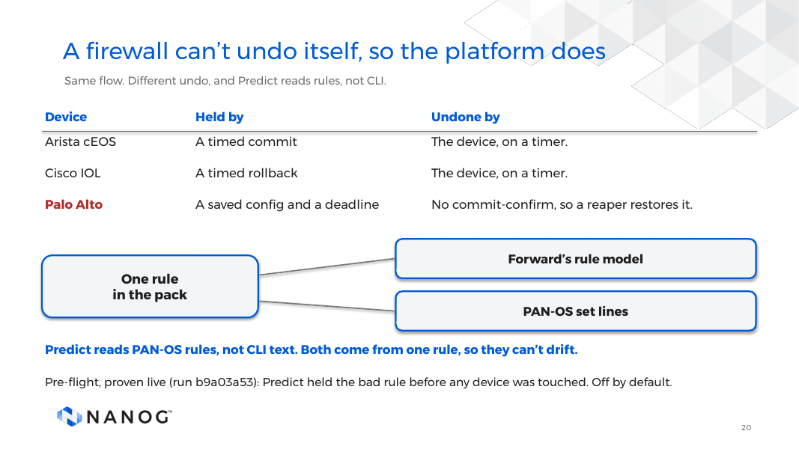

Speaker notes

DELIVERY 28:50–31:05 (135 seconds).

Same flow, two differences.

First, the undo. Arista EOS and Cisco IOS can roll back on their own: if nobody confirms, the device reverts itself. PAN-OS can't. It has no commit-confirm. So the platform holds the undo. Before the commit it saves a named config, and the server records a deadline. If the hold outlives the deadline, a reaper restores the snapshot. I call that a platform-side revert, not a device timer, because it isn't one. It's a weaker guarantee: if a change cut management access, the platform couldn't reach the firewall to undo it. That's why management-affecting lines on a firewall are refused up front.

Second, what Predict can read. Predict models PAN-OS security rules, structured, through the rule editor. It doesn't read CLI set lines. So the change is written once as a structured rule, and Go renders it two ways: Forward's rule model, and the PAN-OS set lines. What Forward predicted and what the firewall receives come from the same rule, so they can't drift. A raw set line is not predictable. Say that if someone asks.

That's what makes the pre-flight possible. On 2026-10-10, run b9a03a53, Predict staged the bad rule as change set CHG-766 on baseline snapshot 14779 and modelled it as denying the flow from 10.10.101.10 to 10.10.102.10, which should have been permitted. The run was held before any device was touched, and ping across the firewall kept working. Off by default, and structured rules only.

CLICK CUES

1. On click: Device + Held by + Undone by + 4 more.

2. On click: Cisco IOL + A timed rollback + The device, on a timer..

3. On click: Palo Alto + A saved config and a deadline + No commit-confirm, so a reaper restores it..

4. On click: One rule / in the pack + Forward’s rule model + PAN-OS set lines + 2 more.

5. On click: Predict reads PAN-OS rules, not CLI text. Both c.

6. On click: Pre-flight, proven live (run b9a03a53): Predict .

TRANSITION

How I'd like to write changes.

---

## 21. Say the change once: built, run on one change

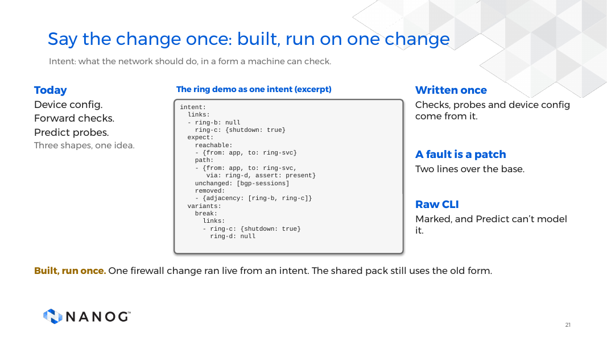

Speaker notes

DELIVERY 31:05–33:00 (115 seconds).

First, what I mean by intent, because the word gets stretched. Intent here is a statement of what the network should do that a machine can check: shut this link, deny this range, this host must reach that one, this path must not change. Changing a vendor, such as swapping one vendor's box for another's, is the kind of thing intent can say, although my compiler handles only two kinds of change today. Intent does not include goals that have no checkable outcome, like reduce cost by 30 percent. If I cannot write down the check, it is not intent, it is a wish.

Now two things on this slide, and I want to keep them apart: what is in use, and what has run once.

What exists: the deployment pack. Each change in it states its device config, its Forward checks and its Predict probes. Three shapes for one idea, and they can drift. That's in use.

What's built: say the change once. One vendor-neutral intent, in netlab's own attribute names. The expected outcomes are written once: who must reach what, which path rides ring-d, which adjacency is meant to disappear. The checks, the probes and the per-vendor config are derived from that. A planted fault is a small patch over the base, the break variant on the slide is two lines. Raw CLI that Forward can't model goes through a marked escape hatch.

Why it matters: the same intent drives the lab and the twin. What I apply and what I ask Forward to judge can't disagree.

Status, exactly: built, and run once. The pack loader accepts an intent. When someone runs the change, the server reads the firewall's own running config for the zones and rule names the compiler checks against, and refuses if the read is missing, stale, or the intent names something the firewall does not have. The intent for the firewall change compiled to the same delta as the old form, for the good version and the planted fault. The planted fault was held by the Predict pre-flight before any device was touched. The good version was applied and Forward confirmed it: 118 of 118 checks, no regressions. The live run is 394f25f2-4260-45c2-a576-3492c420bf89. It ran from a deployment's own pack. The shared pack still uses the old form. Earlier, a throwaway prototype compiled the six fleet40 changes and compared its output with the pack of the day: 59 of 60 comparisons matched, 83 of 88 per-device deltas byte-identical; the one failure was a real finding: two hand-written packs ordered their stanzas differently. If someone asks whether it's in use: one change, once. It is not how the pack works yet.

CLICK CUES

1. On click: Today / Device config. / Forward checks. / Predi.

2. On click: v14_n5_code_panel + intent: /   links: /   - ring-b: null /     ring + The ring demo as one intent (excerpt).

3. On click: Written once / Checks, probes and device config .

4. On click: A fault is a patch / Two lines over the base..

5. On click: Raw CLI / Marked, and Predict can’t model it..

6. On click: Built, run once. One firewall change ran live fr.

TRANSITION

What went wrong on the first real firewall.

---

## 22. The twin judged it right. The machinery broke.

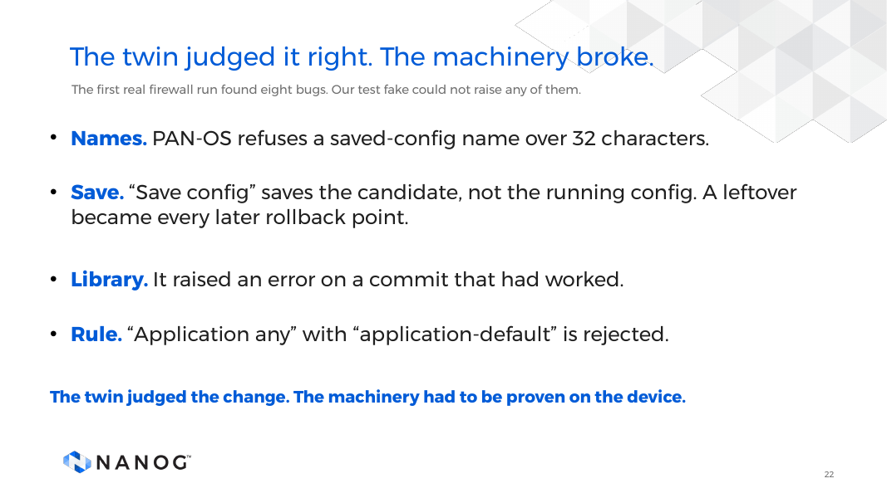

Speaker notes

DELIVERY 33:00–35:20 (140 seconds).

This is the pivot of the talk. The twin judged the change correctly. What broke on the first real firewall run was the machinery that applies and undoes the change.

Eight bugs. Our test fake could not raise any of them. Four of them. PAN-OS refuses a saved-config name over 32 characters. Save config saves the candidate, not the running config, so a leftover from a failed commit became the rollback point of every later change, and every later revert restored the leftover rule. The CLI library raised an error on a commit that had actually worked, so the code now asks the device what it is running instead of believing the library. And application any with application-default is rejected at commit. The other four are in the appendix.

Here's the lesson, and it's the spine of this half of the talk. The twin judged the change. The machinery that applies and undoes it had to be proven on the device. Our test fake tells you your code does what you think it does. It could not raise any of the eight. A firewall tells you what the firewall does, and it has opinions. All eight are fixed, and the fake now raises the way the real library does.

CLICK CUES

1. On click: Names. PAN-OS refuses a saved-config name over 3.

2. On click: Save. “Save config” saves the candidate, not the.

3. On click: Library. It raised an error on a commit that had.

4. On click: Rule. “Application any” with “application-defaul.

5. On click: The twin judged the change. The machinery had to.

TRANSITION

Where AI helps.

---

## 23. AI helps. A person still approves.

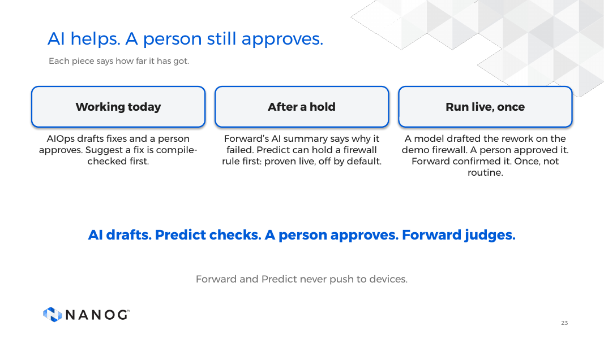

Speaker notes

DELIVERY 35:20–37:00 (100 seconds).

People ask whether I used AI to build this. Yes. But the platform's operations are deterministic, and I want to be exact about where AI sits.

Working today: AIOps triages incidents and drafts bounded fixes. A person approves, and autonomous execution is off. Suggest a fix helps with templates. The change is compiled before I see it, and I accept or reject.

After a hold: Forward writes an AI summary of why a change failed. That summarises Forward's own snapshot diffs, nothing more. And Predict can check a firewall rule before any device is touched. That pre-flight is proven live once and off by default. It works on structured firewall rules, because that is what Predict models.

Run live, once: the loop. On 2026-10-11 the loop ran end to end on the demo firewall. The planted fault was held and reverted, a model drafted the rework, a person approved it, and Forward confirmed it. Two things to say plainly. One: the model's rule was narrow and correct, but I read it before I approved it, and the loop never approves or applies anything itself. Two: it is one lab and one change, so it is a proof, not a track record. The cap on iterations and the breaker for a repeated hold are built; they have not been needed live.

In chat the assistant can start a lab for the person asking, because that is reversible. Irreversible actions need a reviewed approval; the gate is in the appendix. Forward and Predict never push to devices.

CLICK CUES

1. On click: Working today + AIOps drafts fixes and a person approves. Sugges.

2. On click: After a hold + Forward’s AI summary says why it failed. Predict.

3. On click: Run live, once + A model drafted the rework on the demo firewall..

4. On click: AI drafts. Predict checks. A person approves. Fo.

5. On click: Forward and Predict never push to devices..

TRANSITION

What I take away.

---

## 24. What I took away

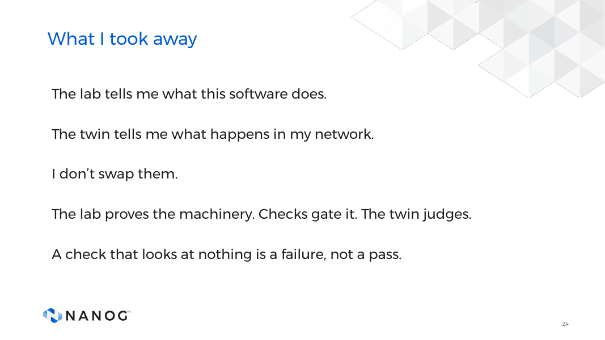

Speaker notes

DELIVERY 37:00–38:15 (75 seconds).

The most useful thing I took away is keeping the two questions apart. The lab tells me what this software does. The twin tells me what happens in my network. I don't swap them.

The abstract promised three things working together: emulation, automated validation and modeling. Here they are. The lab is the emulation. The automated validation is the checks and the regression sweep, which gate the change and fail it when they find something or when they look at nothing. The model is the twin, which judges whether the change does what the network needs.

And on the change-control side, I need all three. The lab proves that the machinery works: it applies the change, holds it, undoes it, on the real device. The twin judges the change. The first real firewall run found eight bugs in the machinery. Our test fake could not raise any of them. Forward judged the change correctly the whole time.

Last one: a check that looks at nothing is a failure, not a pass. A missing result is unknown.

CLICK CUES

1. On click: The lab tells me what this software does..

2. On click: The twin tells me what happens in my network..

3. On click: I don’t swap them..

4. On click: The lab proves the machinery. Checks gate it. Th.

5. On click: A check that looks at nothing is a failure, not .

TRANSITION

The question I ask now.

---

## 25. The question I ask now

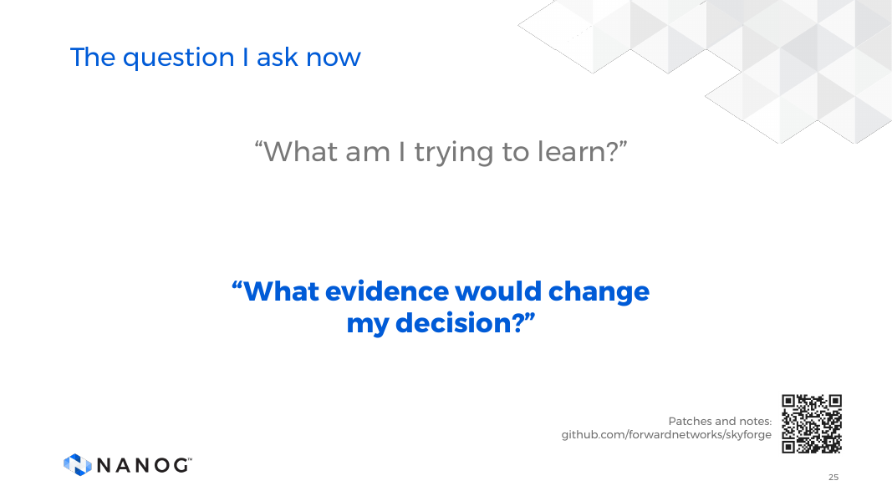

Speaker notes

DELIVERY 38:15–39:00 (45 seconds).

The question I ask now is what I'm trying to learn, and what evidence would change my decision. If the risk is a NOS quirk, I want the lab. If it's a broad path or policy change, I want the twin. If it's a change going onto a real device, I want both: the lab to prove the machinery, the twin to judge the change.

End on that question and pause.

One quiet extra in the corner: a QR code to github.com/forwardnetworks/skyforge. Some of our upstream patch series are published there, with the rest coming after review. Do not spend time on it.

CLICK CUES

1. On click: “What am I trying to learn?”.

2. On click: “What evidence would change / my decision?”.

TRANSITION

Questions.

---

## 26. Questions

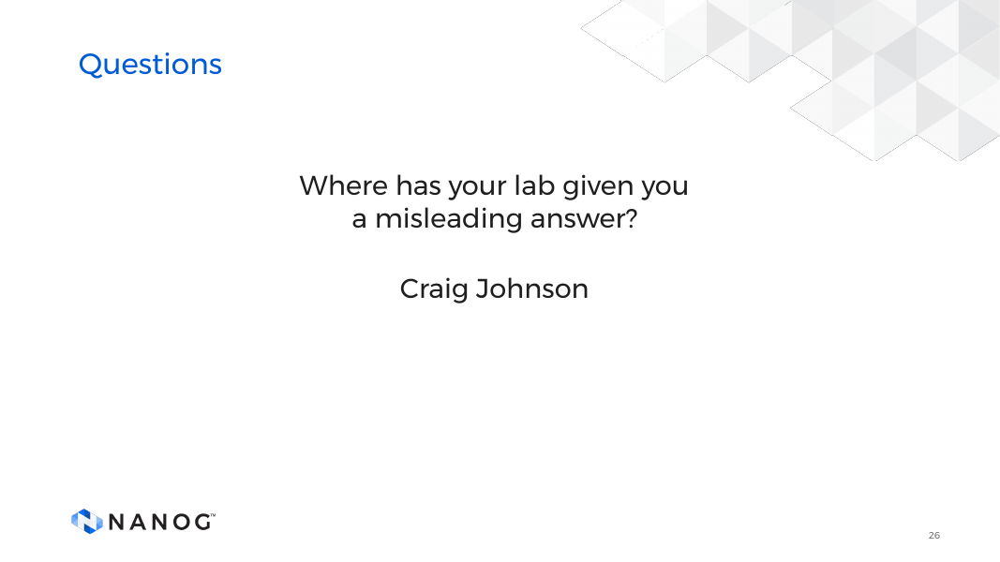

Speaker notes

DELIVERY 39:00–45:00 (360 seconds).

Open Q&A. I would like to hear where a lab result misled someone, what was missing and which evidence eventually explained it.

Useful prompts if needed: How do you record snapshot freshness? Which network features do you still need to exercise on hardware? What makes an unknown result acceptable or unacceptable for a change?

Keep answers grounded in scope. Do not claim the experiment is a measured benchmark: it is one lab, one change, run twice on 2026-10-04, and the model covers only supported behavior.

CLICK CUES

1. On click: Where has your lab given you / a misleading answ.

---

## 27. Appendix: for questions only

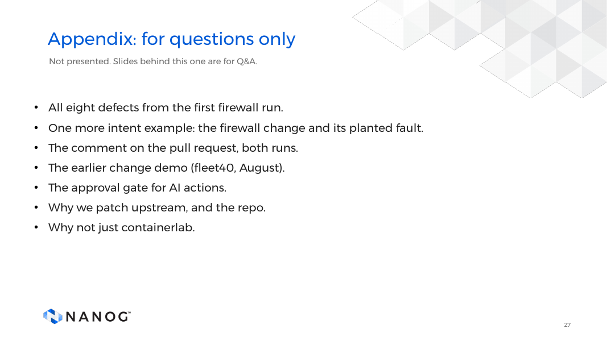

Speaker notes

BACKUP (not presented).

Divider. Everything after this slide is for questions and is not presented.

CLICK CUES

Static slide. Advance after the transition.

---

## 28. Appendix: all eight defects from the first firewall run

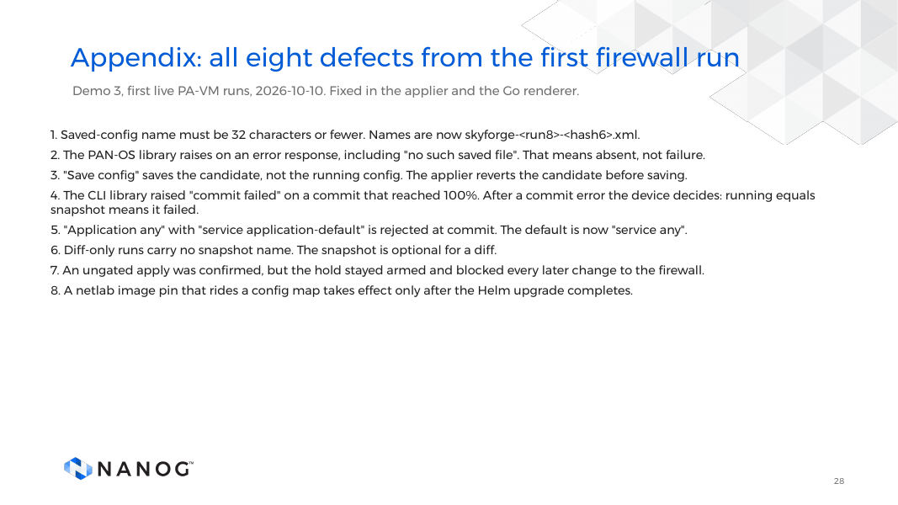

Speaker notes

BACKUP (not presented).

Backup, for questions. These are the eight defects the first live PA-VM runs of demo 3 found, in the order of the note I kept. One to five are about the firewall and the library: names, absent files, candidate versus running, commit text, and the application rule. Six and seven are about our own run bookkeeping: diff-only runs, and a hold that stayed armed after an ungated apply. Eight is about deploys: a config-map pin does not take effect until the Helm upgrade finishes. Every one was invisible to the unit tests, and all are fixed.

CLICK CUES

Static slide. Advance after the transition.

---

## 29. Appendix: the firewall change as one intent

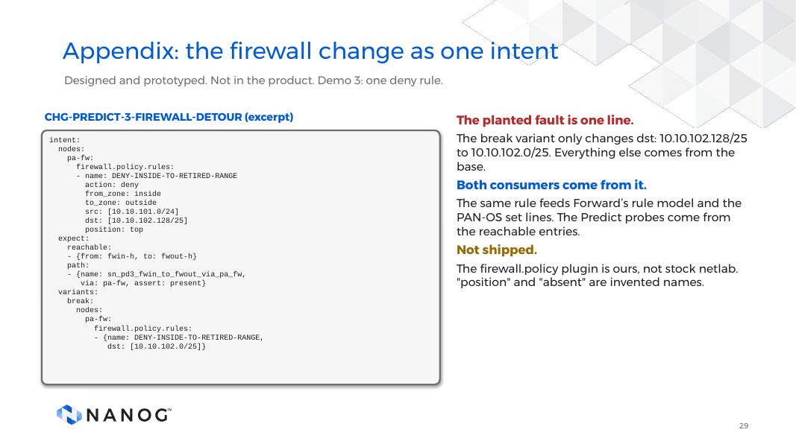

Speaker notes

BACKUP (not presented).

Backup. This is the firewall change from demo 3 written as one intent, from the design draft. The one-digit fault is a one-line patch: the break variant overrides dst with the lower half of the range. The reachable and path entries are where the checks and the Predict probes would be derived from. Two honesty points. The firewall policy plugin is ours, not stock netlab, so those names are netlab-style but not upstream. And the position field, and the idea of removal, are names I had to invent because netlab has no equivalent. This is designed and prototyped, not shipped.

CLICK CUES

Static slide. Advance after the transition.

---

## 30. Appendix: the comment on the pull request

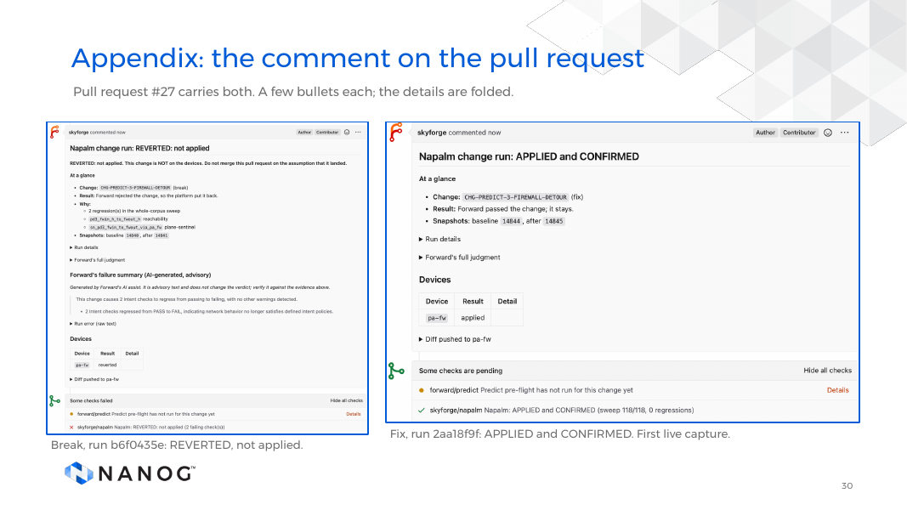

Speaker notes

BACKUP (not presented).

Backup. The two comments on pull request #27, one per run. Break, run b6f0435e: REVERTED, not applied, with the reasons and Forward's advisory AI summary. Fix, run 2aa18f9f: APPLIED and CONFIRMED, status check green, sweep 118 of 118 with 0 regressions. The pending Predict pre-flight line is expected: the pre-flight is off by default.

CLICK CUES

Static slide. Advance after the transition.

---

## 31. We patch upstream, in small series, on pinned versions

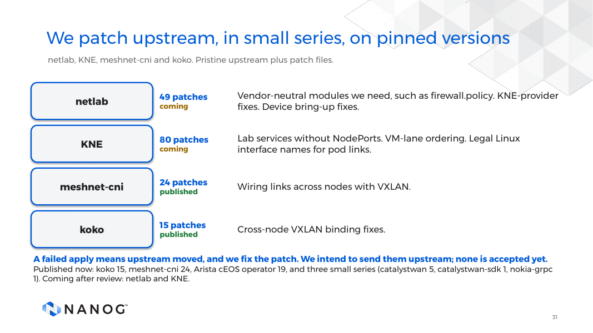

Speaker notes

BACKUP (not presented).

I did not build this on stock parts, and I want to say why. The upstream tools are good. Each one needed changes to run many labs for many people.

The rule I follow: the upstream tree is pristine, at a pinned version, and everything I change is a patch file. Forty-nine on netlab, eighty on KNE, twenty-four on meshnet-cni, fifteen on koko. If an upstream release moves under a patch, the apply fails, and I fix the patch. There is no private fork branch hiding changes.

What the patches are for, one line each. On netlab: vendor-neutral modules we need, such as a firewall policy plugin, fixes to the KNE provider, and device bring-up fixes. On KNE: lab services that do not hold NodePorts, the ordering of virtual-machine nodes, and legal Linux interface names for the pod links. On meshnet-cni: wiring links across nodes with VXLAN. On koko: fixes to how a cross-node VXLAN binds.

Published now on our GitHub: koko fifteen, meshnet-cni twenty-four, the Arista cEOS operator nineteen, and three small series, catalystwan, catalystwan-sdk and nokia-grpc, sixty-five patches in all. The netlab and KNE series are the big ones and follow after review; one netlab patch, the forward-importer, will not be published; I will not promise a date. I intend to send them upstream. Nothing is accepted upstream yet. The last audit of the register, in July, found no pull requests filed, and I would rather say that than imply otherwise.

CLICK CUES

Static slide. Advance after the transition.

TRANSITION

What a declaration looks like.

---

## 32. Appendix: the August change demo, fleet40

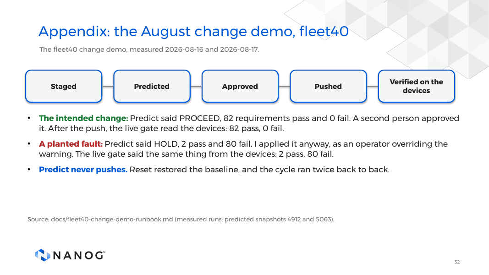

Speaker notes

BACKUP (not presented).

Backup. This is the earlier change demo, measured on the sixteenth and seventeenth of August, on a 40-branch fleet. Predict said proceed on the intended change, 82 requirements pass and none fail, a second person approved it, and after the push the live gate read the devices: 82 pass, none fail. The planted fault: Predict said hold, 2 pass and 80 fail. I applied it anyway, as an operator overriding the warning, and the live gate said the same from the devices. That is the older path. The change-control loop in the main talk is the newer one: napalm applies it, holds it, and Forward judges.

CLICK CUES

Static slide. Advance after the transition.

TRANSITION

End of appendix.

---

## 33. Appendix: where the AI is allowed to act

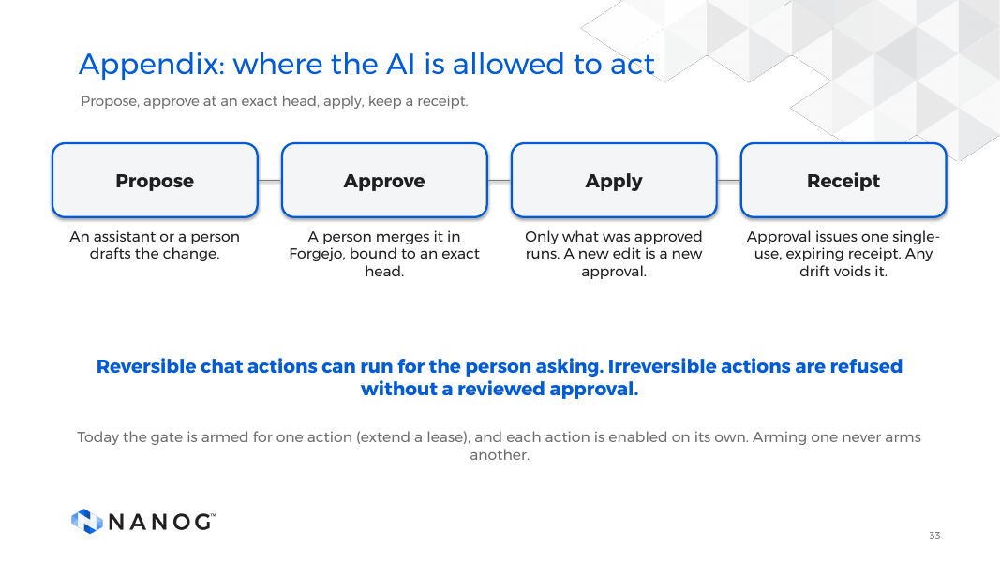

Speaker notes

BACKUP (not presented).

This is the honest version of AI is not an executor. There is a gate, and it has four parts. Something proposes a change: an assistant or a person. A person approves it, by merging it in Forgejo, and the approval is bound to an exact head. So a change edited after approval is a new approval. Only what was approved runs. Approval issues one single-use receipt that expires, and any drift in the target voids it.

Reversible actions in chat, like starting a lab for the person asking, can run without that. Irreversible actions are refused unless there is a reviewed approval.

Today the gate is armed for one action, extending a lease, and each action is enabled on its own. I found and fixed a bug in exactly this today: arming one action had pulled the others into the gate's path. It is fixed so that arming one never arms another. I mention it because a gate you have not tested adversarially is a gate you do not have.

CLICK CUES

Static slide. Advance after the transition.

TRANSITION

End of appendix.

---

## 34. Appendix: why not just containerlab?

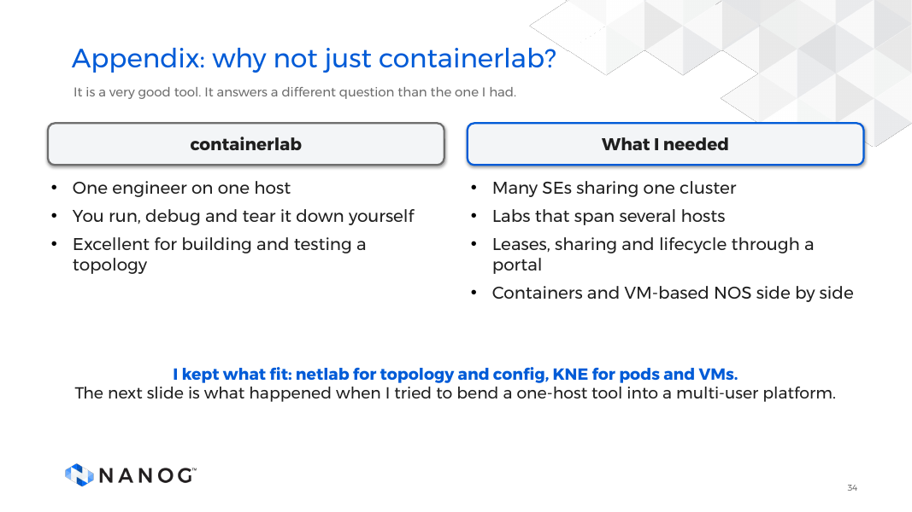

Speaker notes

BACKUP (not presented).

People ask why I did not just use containerlab. It is excellent, and I use its ecosystem. For one engineer building and testing a topology on one machine it is hard to beat.

My problem was a different shape. Many SEs sharing a cluster. Labs that span hosts. Leases, sharing and lifecycle behind a portal. Containers and VM-based network operating systems side by side.

What I kept was what fit: netlab to turn a topology into device configuration, and KNE to turn a topology into pods and VMs on Kubernetes. The honest part is that I tried to fit containerlab in natively first, which is the next slide.

CLICK CUES

Static slide. Advance after the transition.

TRANSITION

End of appendix.

---
